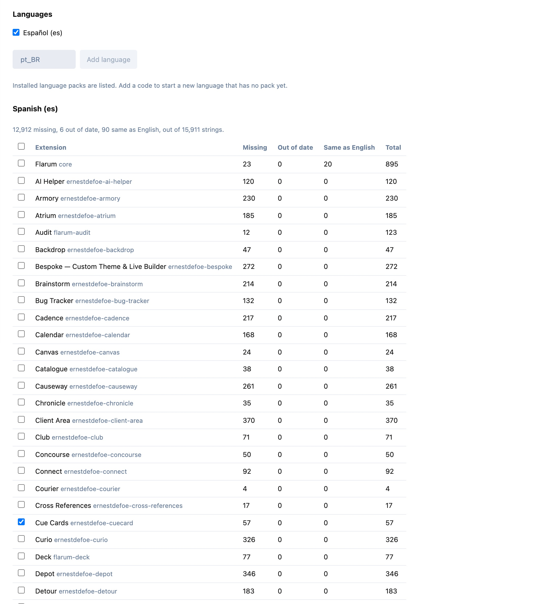
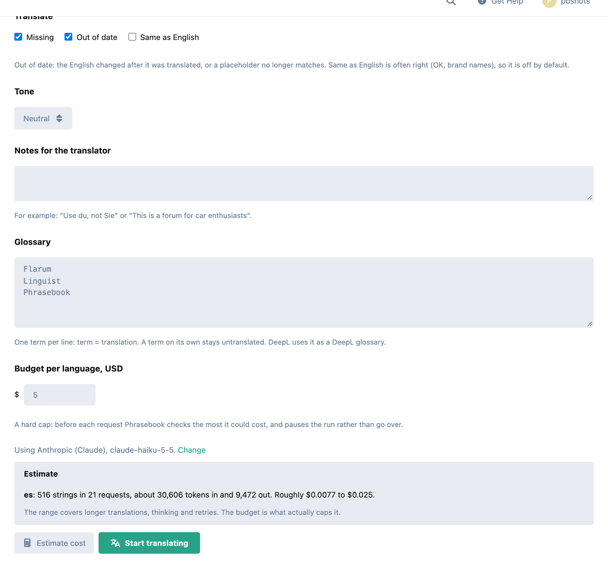
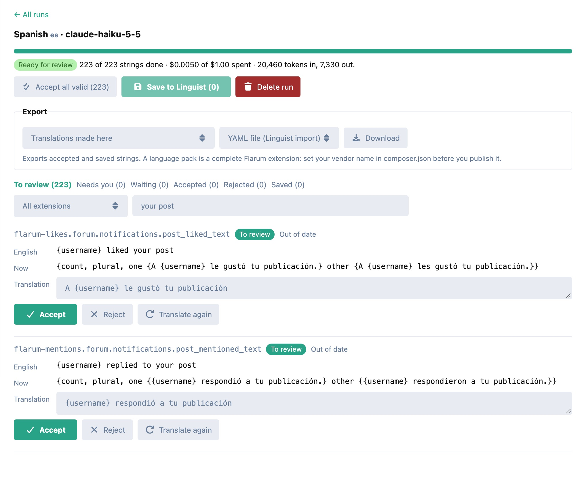
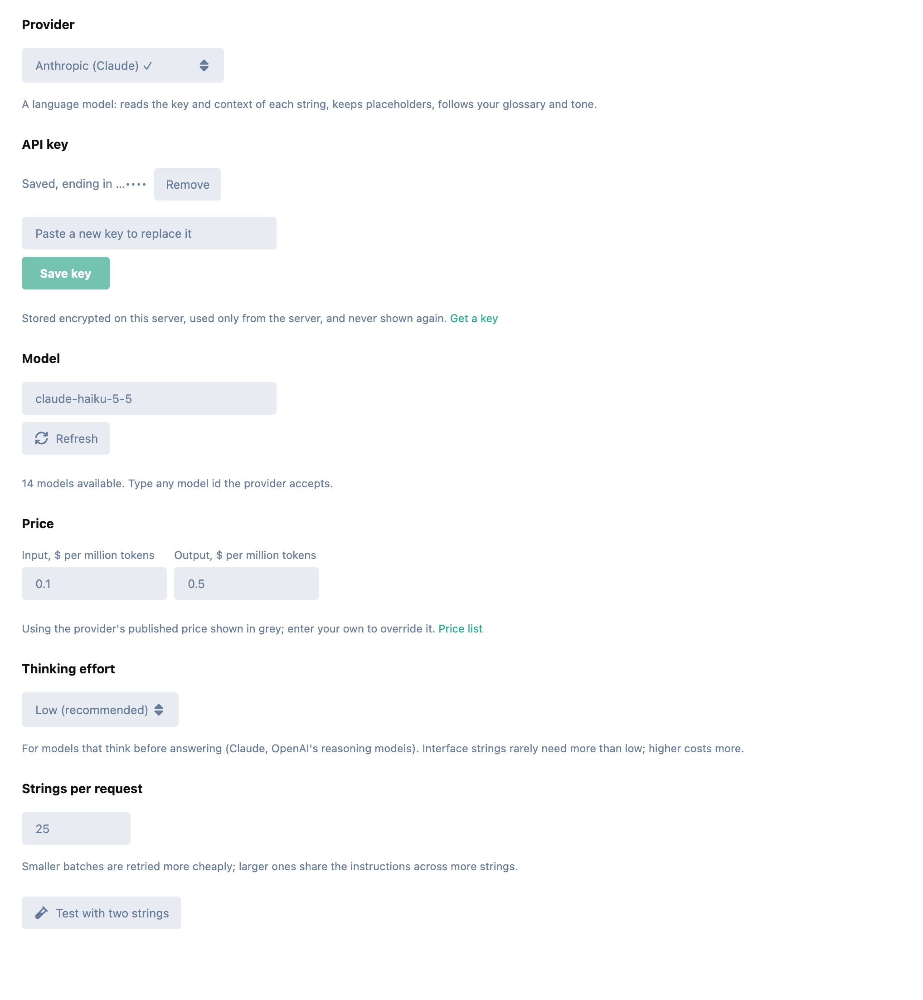

# Phrasebook

Translate your Flarum forum's interface with AI, using your own provider and your own key.

Phrasebook finds every string a language is missing (core and every extension you run), translates them with the model you pick, checks every placeholder, and lets you review each one. Then it saves them as [Linguist](https://github.com/FriendsOfFlarum/linguist) overrides that take effect at once, or exports a complete language pack ready to publish.



## Bring your own provider

| Language models | Translation engines | On your own hardware |
|---|---|---|
| Anthropic (Claude) | DeepL (Free and Pro keys) | Ollama |
| OpenAI | Google Cloud Translation | LM Studio |
| Google Gemini | | Any OpenAI-compatible server |
| Mistral, DeepSeek, Groq | | |
| OpenRouter (hundreds of models) | | |

- **Pick the model from the provider's own list**, fetched with your key, or type any model id it accepts.
- **Your key stays yours.** It is encrypted on your server with a key kept outside the database, sent only to the provider, and never shown again (only its last four characters). It is never in the forum's settings, its pages, its logs or a stack trace.
- **Test with two strings** before you start: one of them a plural, to see the model keep ICU intact.

## Find what is missing

Pick one language or several, installed or brand new (`pt_BR`, `zh_Hans`...). For each, Phrasebook lists every extension with:

- **Missing:** English has the string, the language doesn't;
- **Out of date:** the English changed after Phrasebook translated it, or a placeholder in the translation no longer matches the English (these break or mislead today);
- **Same as English:** often untranslated, sometimes rightly ("OK", brand names), so off by default.

Untick any extension you don't want translated.

## Translate safely

- **Every placeholder is protected.** Strings are ICU MessageFormat: `{username}`, `{count, plural, one {# reply} other {# replies}}`, `{gender, select, ...}`, `<a>links</a>`. Every answer is parsed and checked against its English: a placeholder lost, added, renamed or retyped, a select branch missing, a plural without `other`, an `=0` case dropped, a tag lost or added or left open, any other markup, an apostrophe that would hide a placeholder or a tag (French `l'{username}`, `l'<a>`), or a bare `<` that the browser would read as a broken tag is rejected and sent back with the reason, up to three times. Plural categories may differ from English: Russian gets `one`, `few`, `many` and `other`.
- **DeepL and Google never see ICU.** Placeholders and plural/select syntax are hidden from them and put back afterwards, and each branch of a plural is translated on its own.
- **A glossary** (`discussion = Diskussion`; a term alone stays untranslated), **a tone** (neutral, formal, informal) and **notes** ("Use du, not Sie"). DeepL gets the glossary as a DeepL glossary and the tone as its formality.
- **Translations are text, never HTML.** The review page shows everything as text, and nothing that could become an element can be saved.

## Know the cost before you start



- **A dry-run estimate** for each language: strings, requests, tokens (or characters) and a cost range.
- **A hard budget per language.** Before every request Phrasebook works out the most it could cost (every output token the request allows, the instructions written to the cache) and pauses the run rather than go over. Prices for Claude, DeepL and Google are built in, OpenRouter's come from its model list, local models are free, and for any other model you enter the price from the linked price list; a run won't start without one.
- **Real usage** from each response: tokens in and out, cache reads and writes, thinking, characters; OpenRouter's exact cost when it reports one.

## Runs that look after themselves

- **Queued, in small batches.** With a queue worker a run is a chain of short jobs, one batch each. Without one, the admin page does the work, one batch per request, while it stays open.
- **Rate limits are waited out** (the provider's `retry-after`, else backing off up to five minutes). A batch too long for the model is split in half, and a string that still fails alone is set aside for you. A run pauses itself after repeated failures or a rejected key, and resumes where it stopped.
- **Stop, resume, retry** any time.

## Review, then save or export



- Every string with its key, its English, what the language has now, and the proposed translation, editable. **Accept**, **reject**, **translate again**, or **accept all valid** at once. An edit is checked like a model's answer.
- **Save to Linguist:** accepted strings become Linguist overrides for that language and show on the forum right away.
- **Export:**
  - a **YAML file**, the shape Linguist's import takes;
  - a **language pack** (zip): `composer.json`, `extend.php`, one YAML file per extension (named so Flarum loads it only while that extension is enabled), a README and an MIT licence. Set your vendor name and it's ready to publish.
  - Either can hold just the translations made here, or everything the language has with them on top.



## Security

- Every endpoint is for administrators only, checked before anything else runs.
- Keys: encrypted at rest (libsodium, or AES-256-GCM without it) with a key file in `storage/phrasebook/`, readable by the web server's user only; never in Flarum's settings, its payloads, logs or stack traces.
- Outgoing calls: http(s) only; no credentials or backslashes in the address; numbers only as canonical IP addresses; every address a name resolves to is checked, and the connection is pinned to it; no redirects or proxies; size and time limits. Addresses on your own machine or network are refused unless you switch on **Allow local models**, and cloud metadata addresses are refused even then. Plain http is accepted only for local models, so a key never crosses the internet unencrypted.
- Hosted providers have fixed addresses: a key meant for OpenAI can't be sent anywhere else.

## Performance

A real run on a forum with 150 extensions: 223 Spanish strings translated by Claude Haiku 5.5 in 9 requests and about 30 seconds on the queue, every one valid on the first try, for half a cent.

Admin only, from end to end: nothing on any forum page (no JavaScript, CSS or payload), no listeners, nothing that runs during a page view. The admin page adds 2 KB (gzipped) to the admin bundle; the screens themselves load only when you open Phrasebook. A scan of 16,000 strings across 150 extensions takes under 0.1 s.

## Installation

```sh
composer require ernestdefoe/phrasebook
php flarum migrate
php flarum cache:clear
```

Enable **Phrasebook** in the admin panel. Install [fof/linguist](https://github.com/FriendsOfFlarum/linguist) 2.0.0 or newer to save translations straight to the forum (older versions show placeholders wrongly in emails); without it, export them.

Optional PHP extensions: `zip` (language-pack export; YAML export works without it) and `intl` (language names).

## Updating

```sh
composer update ernestdefoe/phrasebook
php flarum migrate
php flarum cache:clear
```

## Links

- [Support](https://ernestdefoe.online)
- ☕ [Buy me a coffee](https://buymeacoffee.com/ernestdefoe)
